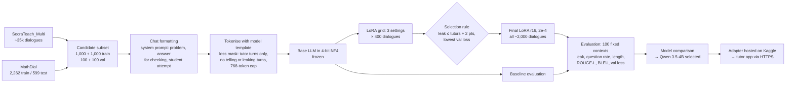

# Socratic Response Model — Milestone 3 Report

**Project:** Group 2 DS & AI Lab — AI Socratic tutor for NCERT Classes 6–10
**Author:** Hariom Kumar (Qwen 3.5-4B, Gemma 4 E4B, Qwen3-4B trial) · Phi-4-mini run by Sandeep Nalla with the same notebook
**Date:** 5 November 2026

---

## 1. Summary

The tutor needs a model that replies like a Socratic maths teacher: one short question or hint per turn, correcting mistakes without giving away the final answer. We fine-tuned four open models of 4B parameters or fewer with QLoRA on a single Kaggle T4. Three of them used an identical protocol and are compared directly.

| | Real tutors | Gemma 4 E4B | **Qwen 3.5-4B** | Phi-4-mini |
|---|---:|---:|---:|---:|
| Leak rate (lower) | 0.01 | 0.00 | **0.00** | 0.00 |
| Question rate | 0.62 | 0.69 | 0.59 | 0.65 |
| Words per reply | 22.2 | 20.5 | 20.3 | 21.8 |
| ROUGE-L (higher) | — | 0.319 | **0.331** | 0.294 |
| BLEU (higher) | — | 0.175 | **0.176** | 0.174 |
| MathDial ROUGE-L | — | 0.228 | **0.244** | not reported |
| Training time, final model | — | 62 min | 80 min | **49 min** |

**Selected model: Qwen 3.5-4B (LoRA r16, learning rate 2e-4).** It has the highest overlap with real tutors overall and on MathDial (the error-correction data), no answer leaks, an Apache 2.0 licence, and it is already served to the demo app. The three fine-tuned models are close: with 100 evaluation contexts, differences of about 0.01–0.04 ROUGE-L should be treated as a near tie, and the final choice will be confirmed on the held-out MathDial test split.

---

## 2. Model architecture selection

All candidates are decoder-only transformer language models, fine-tuned with **QLoRA**: the base model is loaded in 4-bit NF4 and frozen, and small low-rank adapters are trained on the attention and MLP projections.

| Model | Size | Architecture notes | LoRA target modules | Licence |
|---|---|---|---|---|
| **Qwen 3.5-4B** (`Qwen/Qwen3.5-4B` @ `851bf6e8`) | 4B | Hybrid: linear-attention layers plus full-attention layers; thinking mode turned off | `q,k,v,o,gate,up,down_proj` | Apache 2.0 |
| **Gemma 4 E4B** (`google/gemma-4-E4B-it` @ `ee0ef602`) | ~4B effective (per-layer embeddings) | Multimodal base; vision/audio towers excluded from LoRA | language-model `q,k,v,o,gate,up,down_proj` | Gemma terms |
| **Phi-4-mini** (`microsoft/Phi-4-mini-instruct` @ `cfbefacb`) | 3.8B | Phi-3 family: fused `qkv` and `gate_up` projections | `qkv_proj, o_proj, gate_up_proj, down_proj` | MIT |
| Qwen3-4B-Instruct-2507 (early trial) | 4B | Dense transformer | `q,k,v,o,gate,up,down_proj` | Apache 2.0 |

The overall approach: compare each model untrained (baseline), pick its LoRA setting by a small grid search on a candidate subset, train the chosen setting on the full candidate set, and compare models on the same evaluation contexts.

---

## 3. Architecture justification

**Why fine-tune a small open LLM rather than prompt a large one.**

- **Behaviour, not knowledge, is the gap.** Untrained models explain and solve instead of asking. The baselines wrote 40–56 words per reply against the human 22, and Phi-4-mini stated the answer in 6% of replies. Fine-tuning on real tutoring dialogues fixes the style directly.
- **Cost and control.** A 4B model runs on one free Kaggle T4 (16 GB) and can be hosted by the team, so student data does not go to a commercial API.
- **Evidence from the literature.** The MathDial authors found small fine-tuned models (Flan-T5 780M) told students the answer far less often than prompted ChatGPT (Telling@5 under 1% against 16%) [3]. SocraticLM, a fine-tuned 6B model, beat GPT-4 on Socratic teaching quality [4].

**Why LoRA / QLoRA.** Training only 10–35M parameters (about 0.3–0.9% of the model) fits in T4 memory with 4-bit weights, trains in under 1.5 hours, and produces a small adapter that can be swapped on one base model [1, 2].

**Why these models.** They are the strongest openly licensed instruction models that fit a T4 in 4-bit, and they come from three different families, which makes the comparison informative.

**Design decisions and modifications.**

- **Loss only on tutor turns.** Student turns and the system prompt are context. Tutor turns that leak the answer, and MathDial turns labelled "telling", stay in context but are not training targets, so the model never learns to give answers away.
- **End-of-turn token trained.** The model learns to stop after one turn instead of inventing the student's reply.
- **Answer in the prompt, for checking only.** The system prompt contains the correct answer so the tutor can judge the student's work, with an explicit instruction never to reveal it. Leak rate is then measured.
- **No `prepare_model_for_kbit_training`.** It casts 16-bit weights to fp32, which does not fit on a T4 for Gemma's per-layer embeddings; gradient checkpointing is enabled directly instead.
- **fp16 safety check.** The T4 has no bf16, so each notebook checks that a forward pass is finite before training.

**Trade-offs considered.**

| Trade-off | Decision |
|---|---|
| Larger models (7–8B) would likely score higher | Do not fit a free T4 for training with this sequence length; kept ≤4B |
| Long dialogues vs memory | 768-token cap; long dialogues are cut back to the last tutor turn that fits (about 22% of training dialogues) |
| More epochs vs overfitting and time | 1 epoch; validation loss was still falling slowly, so more data is a better next step than more epochs |
| Reference-overlap metrics vs teaching quality | ROUGE/BLEU reward wording, so leak rate, question rate and length are reported beside them |

---

## 4. Candidate dataset

Instead of the full corpora (SocraTeach_Multi has about 35,000 dialogues; MathDial has 2,262 train and 599 test), all experiments use a **candidate subset** for fast comparison:

| Split | SocraTeach | MathDial | Use |
|---|---:|---:|---|
| `candidate_train` | 1,000 | 1,000 | Grid search (same 400-dialogue subset for every model) and final training |
| `candidate_val` | 100 | 100 | 100 evaluation contexts (50 per source) and 100 validation-loss dialogues (50 per source) |
| MathDial test | — | 599 | **Untouched**, kept for the final evaluation |

DATA_PREP_DETAILS

---

## 5. Baseline performance (no training)

Each pretrained model was loaded in 4-bit and asked to write the next tutor turn on the 100 evaluation contexts.

| Baseline | Leak rate | Question rate | Words | ROUGE-L | BLEU | Val loss |
|---|---:|---:|---:|---:|---:|---:|
| Real tutors | 0.01 | 0.62 | 22.2 | — | — | — |
| Gemma 4 E4B | 0.00 | 0.87 | 48.0 | 0.189 | 0.040 | 2.76 |
| Qwen 3.5-4B | 0.01 | 0.52 | 56.4 | 0.190 | 0.040 | 1.82 |
| Phi-4-mini | 0.06 | 0.60 | 39.6 | 0.226 | 0.071 | 1.85 |

**Metrics.**

- **Leak rate:** share of replies that state the final numeric answer before the student has said it. Lower is better.
- **Question rate:** share of replies containing a question. A Socratic tutor should be near the human rate.
- **Words:** reply length; closer to the human tutors is better.
- **ROUGE-L** [6] and **BLEU** [7] (sacreBLEU, divided by 100): word overlap with the real tutor's next turn.
- **Validation loss:** masked loss on tutor turns of 100 validation dialogues. It depends on the tokenizer, so it is compared only within one model.

**Observations.** Untrained models explain at length (2–2.5× the human length) instead of asking. Gemma asks a lot of questions but buries them in long explanations. Phi-4-mini is the most concise baseline but leaks the answer in 6 of 100 replies. On MathDial, where the student has made an error, baseline ROUGE-L is only 0.11–0.12 for Gemma and Qwen: the models solve the problem rather than probe the student's mistake.

**Industry benchmarks (reference only).** Published results use different splits and metrics, so they frame our numbers rather than rank them.

| Source | Setting | Reported result |
|---|---|---|
| MathDial [3] | Flan-T5 780M fine-tuned, MathDial test | sacreBLEU 9.7; interactive Telling@5 under 1% vs 16% for ChatGPT |
| SocraticLM [4] | ChatGLM3-6B fine-tuned on SocraTeach, vs GPT-4 | ROUGE-L 47.5 vs 32.4; BLEU-4 48.6 vs 36.2; overall quality 0.62 vs 0.50 |
| This work | Qwen 3.5-4B, 50 MathDial validation contexts | sacreBLEU 5.6, ROUGE-L 24.4 |
| This work | Qwen 3.5-4B, 50 SocraTeach validation contexts | ROUGE-L 41.9, BLEU 21.7 |

Our SocraTeach ROUGE-L (41.9) is in the range SocraticLM reports for a fine-tuned 6B model (47.5) and above GPT-4's (32.4). Our MathDial BLEU is below the paper's Flan-T5 because ours is on 50 validation contexts with one reference each, against their full test set. The MathDial test split will be used for a like-for-like number.

---

## 6. Hyperparameter tuning

**Search strategy:** grid search, 3 settings, each trained for 1 epoch on the same 400 candidate dialogues (about 50 optimizer steps), then scored on the same 100 contexts.

| Hyperparameter | Values tried | Fixed |
|---|---|---|
| LoRA rank r (alpha = r) | 8, 16 | dropout 0.05 |
| Learning rate | 2e-4, 5e-5 | cosine schedule, 5% warm-up, 8-bit paged AdamW |
| — | — | batch 1 × 8 accumulation (effective 8), max length 768, 1 epoch, seed 42 |

**Rationale.** 2e-4 is the usual QLoRA learning rate [2]; 5e-5 tests whether a gentler update keeps more of the base model's behaviour. Rank 8 vs 16 tests whether more adapter capacity helps. Alpha = r keeps the LoRA scale at 1.

**Selection rule (fixed before training):** lowest validation loss among settings whose leak rate is at most 2 points above the real tutors' (0.01 + 0.02).

| Setting (400 dialogues) | Gemma leak / Q / ROUGE-L / val loss | Qwen 3.5 leak / Q / ROUGE-L / val loss |
|---|---|---|
| r8, 2e-4 | 0.02 / 0.59 / 0.250 / 1.260 | 0.00 / 0.59 / 0.302 / 1.169 |
| **r16, 2e-4** | **0.00 / 0.66 / 0.267 / 1.233** | **0.00 / 0.54 / 0.308 / 1.154** |
| r8, 5e-5 | 0.03 / 0.60 / 0.216 / 1.406 | 0.01 / 0.72 / 0.259 / 1.255 |

- **r16 at 2e-4 won for both models**, and for Phi-4-mini as well (per its model card).
- **The low learning rate under-trains:** it has the highest validation loss, the lowest overlap, and the most leaks for Gemma.
- **Rank 16 is better than rank 8 at the same learning rate,** with lower loss and higher overlap, at 12–19 minutes of training either way.

**Impact of tuning: baseline vs final model** (selected setting on all ~2,000 dialogues).

| | Gemma 4 E4B | Qwen 3.5-4B | Phi-4-mini |
|---|---|---|---|
| Leak rate | 0.00 → 0.00 | 0.01 → **0.00** | 0.06 → **0.00** |
| Question rate (human 0.62) | 0.87 → 0.69 | 0.52 → 0.59 | 0.60 → 0.65 |
| Words (human 22.2) | 48.0 → **20.5** | 56.4 → **20.3** | 39.6 → **21.8** |
| ROUGE-L | 0.189 → 0.319 (+69%) | 0.190 → 0.331 (+74%) | 0.226 → 0.294 (+30%) |
| BLEU | 0.040 → 0.175 | 0.040 → 0.176 | 0.071 → 0.174 |
| Validation loss | 2.76 → 1.12 | 1.82 → 1.07 | 1.85 → 1.17 |

Per source (50 contexts each):

| Final model | SocraTeach ROUGE-L | MathDial ROUGE-L | SocraTeach Q rate (human 0.80) | MathDial Q rate (human 0.44) |
|---|---:|---:|---:|---:|
| Gemma 4 E4B | 0.409 | 0.228 | 0.80 | 0.58 |
| Qwen 3.5-4B | **0.419** | **0.244** | 0.76 | 0.42 |
| Phi-4-mini | not reported | not reported | — | — |

Fine-tuning brings every model to human-like length, removes answer leaks, and lifts overlap with real tutors by 30–74%. Qwen's question rate per source matches the humans most closely (0.76 vs 0.80; 0.42 vs 0.44).

**Early trial: Qwen3-4B-Instruct-2507.** Before the shared protocol, one run used TRL's `SFTTrainer` on a different split: 440 dialogues (220 per source) split by problem hash, giving 2,344 turn-level examples up to 1,024 tokens, LoRA r16 / alpha 32 at 2e-4, 146 steps, 41 minutes, 7 GB peak memory. Its validation loss fell from 1.24 to 1.19 (token accuracy 0.69), but it recorded no generated replies and used different validation data, so it is reported as a feasibility check and not ranked.

---

## 7. End-to-end setup

| Stage | Detail |
|---|---|
| **Input data flow** | JSONL dialogues → per-dialogue chat messages (`system`, `user` = student, `assistant` = tutor) → model chat template (Qwen thinking mode off) |
| **Architecture** | Frozen 4-bit base + LoRA adapters on attention and MLP projections; 10.6–34.9M trainable parameters |
| **Training** | Hugging Face `Trainer`, 1 epoch, effective batch 8, fp16, gradient checkpointing, checkpoints every 25 steps so a Kaggle disconnect resumes |
| **Validation** | Masked loss on 100 validation dialogues; leak-gated selection among grid settings |
| **Evaluation** | One tutor turn per evaluation dialogue, chosen with a fixed seed independent of the model; greedy decoding, stop at end-of-turn, ≤96 new tokens; runaway and empty replies counted (none occurred) |
| **Expected output** | One short tutor turn (about 20 words): a probing question or hint that points at the student's error, without the final answer |
| **Deployment** | The Qwen 3.5-4B adapter is served from a Kaggle notebook behind an authenticated HTTPS tunnel; the NCERT tutor app sends the conversation plus retrieved textbook passages and screens replies for answer leakage |

---

## 8. Limitations

- **Small evaluation:** 100 contexts, so 1–2 leaks or ~0.01–0.04 ROUGE-L are within noise. No confidence intervals yet.
- **Validation, not test:** contexts come from `candidate_val`. The MathDial test split (599) is untouched and is the planned final evaluation.
- **Reference overlap ≠ teaching quality:** a good reply worded differently scores low; there is no human or LLM-judge rating yet.
- **Leak check is narrow:** it catches single-number answers, not answers in words or multi-step reveals.
- **Phi-4-mini per-source results** are not in the model card yet, and the Qwen3-4B trial is not comparable.
- **English maths word problems only;** the NCERT app adds science topics the model was not trained on.

## 9. Next steps

1. Evaluate the three final adapters on the MathDial test split, with bootstrap confidence intervals.
2. Add an LLM-judge or human rating for "asks instead of tells" and "addresses the student's error".
3. Train on the full corpora (SocraTeach ~35k, MathDial 2,262) with the selected setting.
4. Measure leakage live in the NCERT app with retrieved passages in the prompt.

---

## References

1. Hu et al. *LoRA: Low-Rank Adaptation of Large Language Models.* ICLR 2022. https://arxiv.org/abs/2106.09685
2. Dettmers et al. *QLoRA: Efficient Finetuning of Quantized LLMs.* NeurIPS 2023. https://arxiv.org/abs/2305.14314
3. Macina et al. *MathDial: A Dialogue Tutoring Dataset with Rich Pedagogical Properties Grounded in Math Reasoning Problems.* Findings of EMNLP 2023. https://arxiv.org/abs/2305.14536
4. Liu et al. *SocraticLM: Exploring Socratic Personalized Teaching with Large Language Models.* NeurIPS 2024. https://proceedings.neurips.cc/paper_files/paper/2024/file/9bae399d1f34b8650351c1bd3692aeae-Paper-Conference.pdf
5. Model cards: Qwen3.5-4B (https://huggingface.co/Qwen/Qwen3.5-4B), Gemma 4 E4B (https://huggingface.co/google/gemma-4-E4B-it), Phi-4-mini-instruct (https://huggingface.co/microsoft/Phi-4-mini-instruct); Phi adapter: https://huggingface.co/IITM-2026T3-DSAI-GROUP2/Phi-4-mini-instruct-socratic-tutor
6. Lin. *ROUGE: A Package for Automatic Evaluation of Summaries.* ACL Workshop 2004.
7. Papineni et al. *BLEU: a Method for Automatic Evaluation of Machine Translation.* ACL 2002; Post. *A Call for Clarity in Reporting BLEU Scores* (sacreBLEU). WMT 2018.
