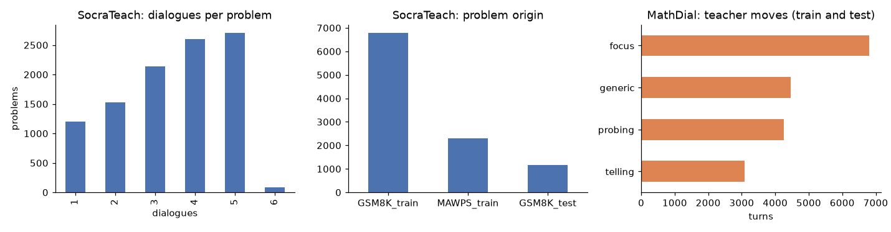
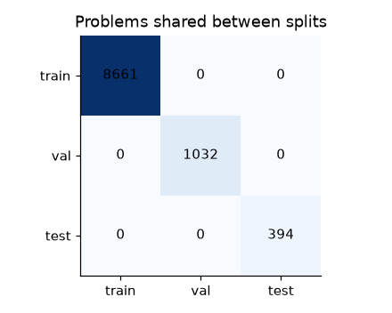
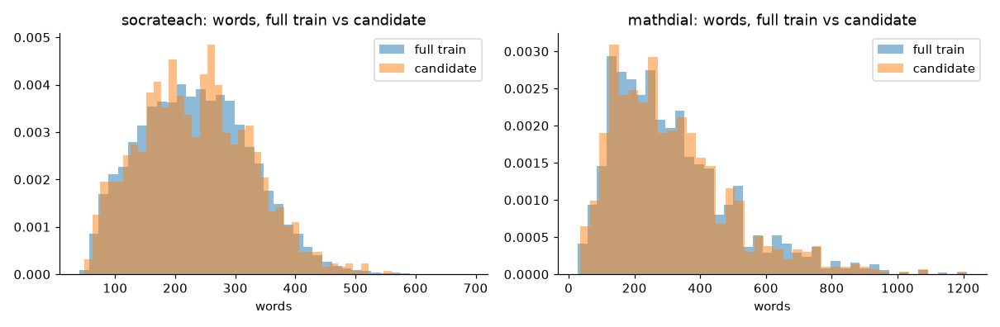
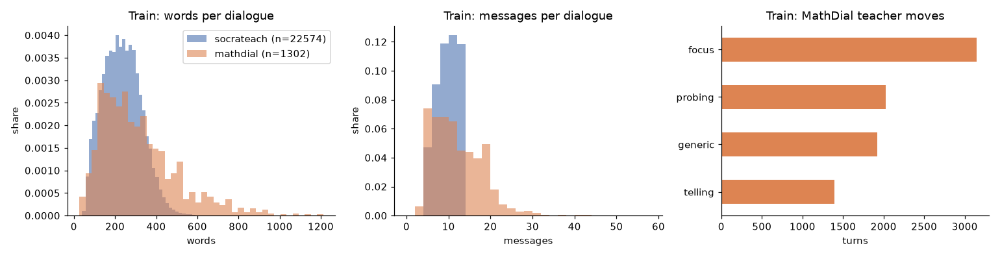

# Socratic Dialogue Data: Preprocessing Report (Milestone 3)

**Project:** Socratic AI Tutor, Group 2, DS & AI Lab
**Author:** Hariom Kumar
**Date:** 3 November 2026
**Code:** `notes/hariom kumar/milestone-3/socratic_data_prep/socratic_dialogue_prep.ipynb`
**Hosted dataset (Kaggle):** https://www.kaggle.com/datasets/hariomkr/socratic

---

## 1. Summary

The tutoring-dialogue data for the Socratic model was rebuilt from the raw SocraTeach_Multi and
MathDial releases. Both sources now share one record format. Every dialogue keeps its problem
text, reference answer and solution, and every tutor turn carries an answer-leak flag. The data
is split by problem, and a held-out test set of real-teacher dialogues never shares a problem
with training or validation.

| Split | Dialogues | Problems | SocraTeach | MathDial |
|---|---:|---:|---:|---:|
| train | 23,876 | 8,661 | 22,574 | 1,302 |
| val | 2,993 | 1,032 | 2,682 | 311 |
| test (MathDial official test) | 599 | 394 | 0 | 599 |
| candidate_train | 2,000 | | 1,000 | 1,000 |
| candidate_val | 200 | | 100 | 100 |

The candidate subset is the experiment set for the M3 model comparison and fine-tuning runs. The
full train and validation splits are for final training.

---

## 2. Before and after at a glance

| Aspect | Before (Milestone 2) | After (Milestone 3) |
|---|---|---|
| Input | Pre-merged file `socratic_tutor_combined.jsonl` (37,413 conversations) | Raw releases at pinned HuggingFace revisions, read from local files |
| Fields per record | `source`, `messages` | `dialogue_id`, `problem_id`, `source`, `official_split`, `problem_origin`, `question`, `reference_answer`, `reference_solution`, `student_attempt`, `n_messages`, `n_words`, `messages` |
| Problem text and answer | Not kept | Kept for every dialogue |
| Speaker roles | `assistant` / `user` | `tutor` / `student` |
| MathDial teacher moves | Removed | Kept per tutor turn (`probing`, `focus`, `telling`, `generic`) |
| SocraTeach student type | Not kept | Kept per student turn (codes 1–6) |
| Answer leaks | Not marked | `leaks_answer` flag on every tutor turn |
| Source name | `soctrateach` | `socrateach` |
| Split unit | None | Problem (shared across both sources) |
| Test set | None | 599 MathDial official-test dialogues, all of their problems removed from train and val |
| Repeats per problem | Up to 6 | At most 3 per problem per source |
| Reproducibility | Colab notebook on a merged file | One notebook plus `download_raw.py`, seed 42, byte-identical reruns |
| Model-specific steps | Mixed into preprocessing | None; tokenisation and prompts live in the fine-tuning notebooks |

---

## 3. Raw data

### 3.1 Sources

| Source | HuggingFace repo @ revision | Licence | Size | Content |
|---|---|---|---|---|
| SocraTeach_Multi | `ulises-c/SocraTeach_Multi` @ `bec77a9c` | CC BY-NC 4.0 | 10,273 problems, 35,151 dialogues | Maths word problems, each with 1–6 dialogues between a tutor and an LLM-simulated student |
| MathDial | `eth-nlped/mathdial` @ `acc38784` | CC BY 4.0 | 2,262 train + 599 test dialogues | Real teachers with LLM-simulated students; every teacher turn labelled with a move |

The original MathDial release is used because it keeps the teacher-move labels.

### 3.2 Fields used

| Source | Field | Used as |
|---|---|---|
| SocraTeach | `id` (e.g. `GSM8K_train_0`) | `problem_origin`: GSM8K train, GSM8K test or MAWPS |
| SocraTeach | `question`, `answer`, `analysis` | `question`, `reference_answer`, `reference_solution` |
| SocraTeach | `dialogues[].turns[]`: `system`, `user`, `user_type` | Tutor turn, student turn, `student_type` |
| MathDial | `qid`, `question`, `ground_truth` | Problem ID, `question`, `reference_solution` (answer taken from its last line) |
| MathDial | `student_incorrect_solution` | `student_attempt` |
| MathDial | `conversation` | Split on `|EOM|` into turns; teacher turns carry a `(move)` prefix |

### 3.3 Labels

| Label | Values | Source |
|---|---|---|
| Speaker role | `tutor`, `student` | Both |
| Teacher move | `probing`, `focus`, `telling`, `generic` | MathDial |
| Student response type | Codes 1–6 | SocraTeach |
| `leaks_answer` (added) | `true` / `false` per tutor turn | Computed in this pipeline |

---

## 4. Exploratory analysis of the raw data



| Finding | Value | Design decision |
|---|---|---|
| SocraTeach dialogues per problem | 1: 1,206 · 2: 1,532 · 3: 2,139 · 4: 2,600 · 5: 2,712 · 6: 84 problems | Split by problem; cap repeats per problem |
| SocraTeach problem origin | GSM8K train 6,798 · MAWPS 2,300 · GSM8K test 1,175 | GSM8K test accuracy is not used as a metric |
| MathDial problems | 1,035 train · 394 test | |
| MathDial test problems also in MathDial train | 318 of 394 | Remove test problems from train |
| Problems shared by SocraTeach and MathDial train | 1,006 | Group problems across sources |
| Problems shared by SocraTeach and MathDial test | 383 | Remove those SocraTeach dialogues from training |
| MathDial teacher moves (train + test) | focus 6,808 · generic 4,456 · probing 4,252 · telling 3,091 | Keep moves so "telling" turns are identifiable |
| Empty messages | Present; dropped | No dialogue lost a role |
| Exact duplicate dialogues | 0 | |

Problems are matched across sources by hashing the normalised problem text (lower-case,
punctuation removed except `. % $`, whitespace collapsed).

---

## 5. Preprocessing pipeline

1. **Load.** Read `raw/*.jsonl.gz` with `json` and `gzip`. `download_raw.py` recreates these files
   from the pinned revisions.
2. **Unify the schema.**
   - SocraTeach: `system` turns become tutor messages; `user` turns become student messages with
     their `student_type`.
   - MathDial: the conversation string is split on `|EOM|`. `Teacher:` turns become tutor messages
     with their `move`; all other speakers become student messages.
3. **Assign problem IDs.** `problem_id = "p_" + sha1(normalised question)[:12]`. A GSM8K problem has
   the same ID in both sources.
4. **Clean messages.** Collapse whitespace, drop empty messages and merge consecutive messages from
   the same speaker. No words, numbers or symbols are changed.
5. **Clean dialogues.** Remove trailing student messages so each dialogue ends on a tutor turn. Drop
   dialogues missing either role, and exact duplicates.
6. **Flag answer leaks.** A tutor turn gets `leaks_answer = true` when it states the final numeric
   answer before the student has. Answers that already appear in the problem text are skipped, and
   numbers inside fractions are ignored. Turns are flagged, never removed.
7. **Record lengths.** Store `n_messages` and `n_words` for EDA and for stratified sampling.

On the train split, `leaks_answer` marks 423 of 120,920 SocraTeach tutor turns (0.3%) and 147 of
8,486 MathDial tutor turns (1.7%). MathDial has 1,394 tutor turns labelled `telling` (16.4%).

---

## 6. Split design

1. **Test:** all 599 MathDial official-test dialogues (394 problems, real teachers).
2. **Leakage removal:** every dialogue that shares a problem with the test set leaves the pool
   (1,245 SocraTeach, 585 MathDial).
3. **Validation:** 10% of the remaining problems, sampled per source with seed 42.
4. **Cap:** train and validation keep at most 3 dialogues per problem from each source.
5. **Checks:** the notebook asserts that no `problem_id` and no `dialogue_id` appears in two splits.



MathDial's 2,262 official-train dialogues end up as follows:

| Outcome | Dialogues |
|---|---:|
| Train | 1,302 |
| Validation | 311 |
| Removed (problem in the test set) | 585 |
| Removed by the cap | 64 |

---

## 7. Candidate subset

The candidate subset is the experiment set for the M3 model comparison (Gemma 4 E4B vs Qwen 3.5-4B)
and the fine-tuning runs. Both models train and evaluate on exactly these files.

- **Train:** 1,000 SocraTeach + 1,000 MathDial dialogues, drawn from the train split.
- **Validation:** 100 SocraTeach + 100 MathDial dialogues, drawn from the validation split.
- **Sampling:** within each source, stratified by word-count quartile (seed 42).
- **Checks:** the notebook asserts that every candidate dialogue belongs to its parent split, so no
  candidate dialogue shares a problem with validation (for train) or test.

### 7.1 Representativeness

Two-sample Kolmogorov–Smirnov tests compare the subset with the full train split, per source.

| Source | Feature | Full train mean | Subset mean | KS statistic | p-value |
|---|---|---:|---:|---:|---:|
| SocraTeach | Words per dialogue | 234.9 | 234.3 | 0.020 | 0.81 |
| SocraTeach | Messages per dialogue | 9.71 | 9.69 | 0.013 | 0.99 |
| SocraTeach | Share of tutor turns that leak | 0.003 | 0.004 | 0.004 | 1.00 |
| MathDial | Words per dialogue | 314.2 | 312.9 | 0.010 | 1.00 |
| MathDial | Messages per dialogue | 12.04 | 12.03 | 0.013 | 1.00 |
| MathDial | Share of tutor turns that leak | 0.017 | 0.017 | 0.004 | 1.00 |
| MathDial | Share of tutor turns "telling" | 0.154 | 0.153 | 0.006 | 1.00 |

Within each source, no feature differs measurably between the subset and the full split.



### 7.2 Source mix

MathDial is 5.5% of the full train split and 50% of the candidate subset. This is deliberate:

- MathDial is the only real-teacher data, and the test set is entirely MathDial.
- At the natural 5.5%, the subset would hold about 110 MathDial dialogues, too few to learn
  real-teacher style or to separate one configuration from another.
- SocraTeach is LLM-generated with several dialogues per problem, so extra SocraTeach dialogues add
  little new information.

For final training on the full split, MathDial is oversampled about 3× (to roughly 15%),
checkpoints are selected on MathDial validation, and all results are reported per source.

---

## 8. Processed data profile



| Split | Source | Dialogues | Words (median) | Words (95th pct) | Messages (median) | Tutor turns that leak | Tutor turns "telling" |
|---|---|---:|---:|---:|---:|---:|---:|
| train | SocraTeach | 22,574 | 232 | 390 | 9 | 0.3% | — |
| train | MathDial | 1,302 | 274 | 689 | 11 | 1.7% | 15.4% |
| val | SocraTeach | 2,682 | 234 | 393 | 9 | 0.4% | — |
| val | MathDial | 311 | 254 | 645 | 11 | 1.8% | 17.4% |
| test | MathDial | 599 | 265 | 603 | 11 | 2.1% | 15.8% |
| candidate_train | SocraTeach | 1,000 | 232 | 391 | 9 | 0.4% | — |
| candidate_train | MathDial | 1,000 | 274 | 689 | 11 | 1.7% | 15.3% |
| candidate_val | SocraTeach | 100 | 234 | 393 | 11 | 0.2% | — |
| candidate_val | MathDial | 100 | 256 | 628 | 11 | 2.0% | 17.6% |

Leak and telling shares are per-dialogue means. SocraTeach has no move labels, so "telling" does
not apply to it. MathDial dialogues are longer and contain more telling and leaks than SocraTeach,
and every split keeps each source's profile.

---

## 9. Before/after examples

**Example 1: SocraTeach `GSM8K_train_0_0` (fields added)**

Before:
```json
{"source": "soctrateach",
 "messages": [{"role": "assistant", "content": "How many clips did Natalia sell in May?"}, ...]}
```
After:
```json
{"dialogue_id": "GSM8K_train_0_0", "problem_id": "p_a3798067808f", "source": "socrateach",
 "problem_origin": "GSM8K_train",
 "question": "Natalia sold clips to 48 of her friends in April...", "reference_answer": "72",
 "messages": [{"role": "tutor", "content": "How many clips did Natalia sell in May?"}, ...]}
```
Message text is unchanged; only context fields are added.

**Example 2: MathDial `mathdial_train_5000012_0` (conversation string split into turns)**

Before:
```text
Teacher: (probing)Steven, If you had 4 of something and tripled that amount, how much would you have?|EOM|Steven: I would have 12 of something.|EOM|...
```
After:
```json
[{"role": "tutor", "move": "probing",
  "content": "Steven, If you had 4 of something and tripled that amount, how much would you have?"},
 {"role": "student", "content": "I would have 12 of something."}, ...]
```
The split uses the dataset's own `|EOM|` separator, and the move label moves into its own field.

**Example 3: SocraTeach `GSM8K_train_6696_0` (answer leak flagged, answer = 97)**

Before:
```text
Student: Is it 95 then?
Tutor:   Yes, exactly! So, if Jack has 47 pounds of sugar tomorrow and then buys 50 more, he will have 97 pounds in total...
```
After: the same tutor message with `"leaks_answer": true`. The turn is kept, and the
fine-tuning stage decides how to use the flag.

**Example 4: MathDial `mathdial_train_5000084_1` (trailing student turn removed)**

Before: 20 turns, ending on the student: *"It will take 29 days to get to 15 high elevation push-ups..."*
After: 19 messages, ending on the tutor: *"You just said 15 + 15= 29!"* (`move: telling`).
A final student turn has no tutor reply to learn from, so it is dropped.

---

## 10. Milestone 2 review items

| MoM ref | Review item | Status in M3 |
|---|---|---|
| 4.2, 7.6, action 09 | Combined split with source proportions reported | Validation drawn from both sources; source counts reported for every split |
| 4.2 | Keep the test set held out | All test problems removed from train and val in both sources; overlap asserted to be zero |
| 7.5, action 07 | Keep the problem field if it carries information | `question`, `reference_answer`, `reference_solution` and `student_attempt` kept |
| 7.3, action 08 | One source-tag spelling | `socrateach` everywhere |
| 7.10, action 02 | Clean, reusable pipeline | One notebook on local raw files plus a pinned download script; deterministic |
| 7.10, action 03 | Full EDA | Sections 4 and 8, four figures |
| 7.10, action 04 | 3–4 before/after examples | Section 9 |
| 8.1 | Manageable subset for comparative runs | Balanced candidate subset of 2,000 + 200 dialogues (about 8% of train), KS-checked |
| 7.10, action 18 | Publish cleaned data where licences allow | Published on Kaggle: https://www.kaggle.com/datasets/hariomkr/socratic (both licences allow it with attribution; SocraTeach non-commercial) |

---

## 11. Outputs and reproduction

The processed dataset is hosted on Kaggle: **https://www.kaggle.com/datasets/hariomkr/socratic**

| Path | Contents |
|---|---|
| `socratic_dialogue_prep.ipynb` | The full pipeline: load, EDA, schema, cleaning, annotation, split, subset, EDA, save |
| `download_raw.py` | Recreates `raw/` from the pinned HuggingFace revisions |
| `candidate_v1_ids.json` | Dialogue IDs of the candidate subset |
| `raw/` | `socrateach_multi_train.jsonl.gz`, `mathdial_train.jsonl.gz`, `mathdial_test.jsonl.gz` |
| `processed/` | `train`, `val`, `test`, `candidate_train`, `candidate_val` (`.jsonl.gz`), `split_problem_ids.json`, `stats.json` |
| `figures/` | Raw overview, train distributions, candidate vs full train, split overlap |

Each message has `role`, `content`, and where applicable `move`, `leaks_answer` and
`student_type`.

To reproduce: run `python download_raw.py` if `raw/` is empty, then run all cells of the notebook
(CPU only, a few minutes; needs pandas, matplotlib and scipy). Outputs are deterministic with
seed 42.

---

## 12. Limitations

- Neither source has real learners: SocraTeach students are LLM-simulated, and MathDial pairs real
  teachers with LLM-simulated students.
- Real-teacher data is limited to 1,302 MathDial train dialogues once test problems are removed.
- `leaks_answer` covers single-number final answers only.
- SocraTeach has no move labels, so telling turns are identifiable only in MathDial.
- SocraTeach contains 1,175 GSM8K test problems, so GSM8K test accuracy is not a valid metric for
  models trained on this data.

## References

- SocraTeach_Multi, HuggingFace `ulises-c/SocraTeach_Multi` (CC BY-NC 4.0)
- MathDial, HuggingFace `eth-nlped/mathdial` (CC BY 4.0)
- Group 2 Milestone 2 Review, Minutes of Meeting, 30 October 2026
