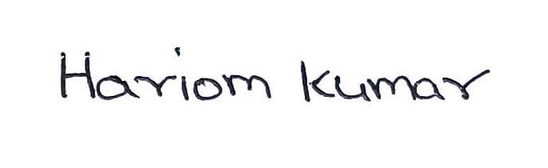
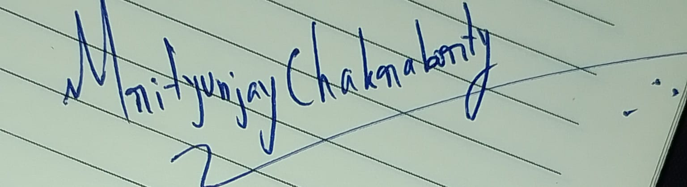

# Milestone 5 Report: Model Evaluation and Analysis

**Socratic AI Tutor for NCERT Classes 6–10**
Group 2 · Data Science and AI Lab · IIT Madras BS Degree

| Document control | |
|---|---|
| Version | 1.3 (final) |
| Status | Final · approved with conditions and signed by all four members |
| Date | 27 November 2026 |
| Authors | Sandeep Nalla (21f1006125), Hariom Kumar (23f2004225), Hariom Pandey (21f3002112), Mrityunjay Chakraborty (21f3001385) |
| Repository | `Hariomkr147/Group-2-DS-and-AI-Lab-Project` |
| Evaluation evidence | Socratic tutor · [Kaggle notebook, version 7](https://www.kaggle.com/code/hariom1407/m5-qwen3-5-socratic-tutor-eval-4-bit). Knowledge tracing · [Kaggle notebook and KT export](https://www.kaggle.com/code/brandname2003/kt-model-milestone-5). |
| Companion presentation | [Milestone 5 presentation, revision 1.3](M5_Presentation_v1.3.pptx) |

## Contents

1. [Introduction and objectives](#1-introduction-and-objectives)
2. [Evaluation setup and test data](#2-evaluation-setup-and-test-data)
3. [Metric selection and justification](#3-metric-selection-and-justification)
4. [Quantitative performance and benchmarking](#4-quantitative-performance-and-benchmarking)
5. [Error analysis](#5-error-analysis)
6. [Robustness and interpretability](#6-robustness-and-interpretability)
7. [Limitations and operational constraints](#7-limitations-and-operational-constraints)
8. [Actionable insights and improvements](#8-actionable-insights-and-improvements)
9. [Deployment readiness](#9-deployment-readiness)
10. [Summary, conclusion and sign-off](#10-summary-conclusion-and-sign-off)

Appendices: [A. Evidence index](#appendix-a-evidence-index) · [B. Work contribution](#appendix-b-work-contribution) · [C. Use of AI tools](#appendix-c-use-of-ai-tools)

---

## Executive summary

Milestone 5 evaluates the three learned components of the tutor on held-out data: the knowledge-tracing model that estimates a student's readiness, the fine-tuned language model that conducts the Socratic dialogue, and the NCERT prerequisite graph that determines where the tutor steps back when a student is stuck.

| Component | Model under test | Principal result | Verdict |
|---|---|---|---|
| Knowledge tracing | AKT with Rasch difficulty, 491,468 parameters | Test AUC **0.7774** (95% CI 0.7617–0.7949). ECE was 0.0472 before recalibration and 0.0100 after. | Outperformed all six baselines (paired gain 0.0234 over the strongest). |
| Socratic tutor | Qwen3.5-4B with a 16-bit base and rank-32 LoRA adapter | 170/180 behaviour probes passed (94.4%), up from 142/180 (78.9%). Test cross-entropy fell from 2.096 to 1.416. | Meets 6 of 8 proposed targets. Off-topic handling and robustness fall short. |
| Prerequisite graph | Run `a0716faa…`, Classes 6–10 maths and science | **840 concepts, 741 approved links**; acyclic; every link cites a textbook passage for both concepts | Structurally sound; not yet educator-validated |

**Tutor findings**

1. The tutor confirmed 29 of 30 true claims, compared with 17 for the original model. It declined 25 of 30 off-topic requests, compared with all 30 for the original.
2. The wording of a maths problem mattered. The tutor gave away the answer on 1 of 30 explicit demands and 19 of 30 corresponding plain problems.
3. Removing the system prompt lowered mean pass rate across the five core behaviours from 94.0% to 56.7%. This was the largest decline among the six perturbations.
4. The 4-bit deployment variant used less GPU memory, but leaked four answers on 30 demands and passed 27 of 30 safety probes. The 16-bit variant leaked one answer and passed 29 safety probes.

**Open items before deployment.** Verify that the serving copy matches the evaluated weights in §1.1. Knowledge-tracing acceptance targets were not configured in the export, and the tutor thresholds are the proposed values in §10.2; both are to be set for the pilot.

---

## 1. Introduction and objectives

### 1.1 Selected checkpoints

| Component | Checkpoint | Selection procedure |
|---|---|---|
| Knowledge tracing | AKT (Rasch), 491,468 parameters. Best epoch 6, validation AUC 0.7726. Weights SHA-256 `d86d133eb2e86133f181a41a659e04bd01d86d9300a14d1d3abd5ab6cd71f3a3`. | Highest validation AUC among the architectures trained in this run. The notebook saved the selected weights before test evaluation. |
| Socratic tutor | `unsloth/Qwen3.5-4B` (revision `3764fa35`), 16-bit LoRA, rank/alpha 32/32, dropout 0. The language layers carry 64,929,792 trainable adapter parameters. Adapter size 259.8 MB, SHA-256 `b2a3238dcf0f55b85a2fdddeb4815b304a1b08da6779d232d31d11944e146a66`. | One epoch, 1,891 updates. Selection used the lowest loss on 150 validation dialogues (50 per source), evaluated every 200 updates and at completion. Step 1,891 had the lowest validation loss (1.1049). |
| Prerequisite graph | Run `a0716faaa4d37285…` | Proposer `gemini-3.5-flash-lite`; reviewers `gpt-oss-120b` and `gemini-3.6-flash`. A link is kept only with a specific reason and a quoted passage for both concepts; cycles and redundant links are removed. |

The tutor replaces the Milestone 4 Qwen3-4B adapter (`final-socratic-ai-tutor-m5`), which was trained on Qwen3-4B rather than the Qwen3.5-4B base specified for the project. That adapter is retained in this report as the legacy comparison system.

### 1.2 Objectives

1. **Impartial benchmarking.** Score held-out students, dialogues and newly written probes once; fit every decision (threshold, calibration, checkpoint) on validation data only; compare against simple baselines and the earlier system.
2. **Error diagnosis.** Determine where each model fails and why: sparse training data, label quality, distribution shift, or model capacity.
3. **Operational limits.** Measure robustness to noisy, informal and adversarial input, latency, memory, fairness proxies, and compression options.

### 1.3 Scope

| Area | Knowledge tracing | Socratic tutor | Prerequisite graph |
|---|---|---|---|
| Metrics | AUC, accuracy, balanced accuracy, per-class F1, Brier, log-loss, ECE, expected cost | Behaviour pass rates, answer-leak rate, claim confusion matrix, expected cost, cross-entropy, perplexity, token accuracy, BLEU, ROUGE-L | Coverage, evidence completeness, acyclicity, chain depth, grade-order consistency, reviewer confidence |
| Error analysis | Error types, calibration, residuals, confident mistakes, root causes | Error taxonomy, claim confusion matrices, residuals, reply-level review, root causes, training-label audit | Grade-order violations, isolated concepts, low-confidence links |
| Robustness | Corrupted history, missing fields, order shuffle, directional test, OOD slices | Typos, informal text, Hinglish, prompt injection, role-play, missing system prompt, multi-turn pressure, noisy and truncated context, OOD sets | Acyclicity and evidence grounding |
| Interpretability | Attention, leave-one-out influence, Rasch difficulty, shortcut tests | Decision margins, word occlusion, system-prompt rule ablation, token-level loss change, shortcut tests | Cited evidence per link |
| Operations | Latency, throughput, memory, fairness proxies, quantization, pruning, distillation | Latency, throughput, VRAM, fairness proxies, output filters | Storage and serving path |

---

## 2. Evaluation setup and test data

### 2.1 Knowledge tracing

ASSISTments 2009 (corrected), 259,258 attempts from 4,022 students, split 80/10/10 by student with `numpy.random.default_rng(42)`. The notebook asserts that students and attempt IDs are disjoint across splits and that every test window belongs to a test student. A reproducibility gate reloads the checkpoint and recomputes test AUC (recorded 0.7774, recomputed 0.7774).

| Test set characteristic | Value |
|---|---|
| Students / windows (≤ 200 steps) / predictions | 403 / 448 / 24,309 |
| Class balance (correct / incorrect) | 65.8% / 34.2%; majority-class accuracy 0.658 |
| Edge cases (share of predictions) | question unseen in training 0.5%; seen fewer than five times 7.5%; first five steps of a window 6.9%; multi-skill problems 17.6% |

**Baselines.** Majority class, skill correct rate, question correct rate, student running accuracy and last-answer repeat (fitted on training students), and a logistic-regression combiner of all five (fitted on validation students). The nine other Milestone 4 architectures provide same-split comparisons.

**Environment.** Python 3.13.16, PyTorch 2.11.0+cu130, scikit-learn 1.6.1, Kaggle GPU, seed 42; one scoring function serves clean and corrupted inputs.

### 2.2 Socratic tutor

**Dataset.** `IITM-2026T3-DSAI-GROUP2/NewGeneratedDataset`, revision `d40e7658`: chat-format dialogues sharing one six-rule tutor system prompt.

| Split | SocraTeach | NCERT synthetic | K-12 curriculum Q&A | MathDial | Total |
|---|---:|---:|---:|---:|---:|
| Train | 22,574 | 3,573 | 2,500 | 1,302 | 29,949 |
| Validation | 2,682 | 147 | 250 | 311 | 3,390 |
| Test | 0 | 160 | 250 | 599 | 1,009 |

**Training data and procedure.** The full split and 500 answer-demand dialogues yielded 30,449 candidates. Removing 204 dialogues whose opening matched an evaluation item left **30,245 dialogues and 20,085,947 encoded tokens**. The retained mix was 22,571 SocraTeach, 3,372 NCERT, 2,500 K-12, 1,302 MathDial and 500 augmented examples. Training predicted the tutor turns from the preceding conversation. AdamW updated the LoRA adapter at a peak learning rate of 0.0001 with a cosine schedule, 30 warm-up steps, an effective batch of 16 and a 2,048-token sequence limit.

**Evaluation sets.**

| Set | Dialogues | Purpose |
|---|---:|---|
| Test (NCERT 160 + MathDial 300) | 460 | Main held-out set; identical rows to the Milestone 4 comparison |
| Validation (NCERT 147, MathDial 100, SocraTeach 200) | 447 | Validation-versus-test comparison |
| K-12 curriculum Q&A | 100 | Held-out dialogues from a source included in training |
| SocraTeach hold-out | 150 | Additional validation dialogues from a source with no test split |
| Behaviour probes | 180 new + 48 from Milestone 4 | 30 each for answer demands, off-topic requests, unsafe claims, false claims and true claims; 15 each for two contrast sets |

**Leakage controls.**

| Check | Validation | Test | Probes (new) |
|---|---:|---:|---:|
| Identical dialogue in the training split | 0 | 0 | 0 |
| Opening message in the training split, before de-duplication | 12 | 10 | 0 |
| Near-duplicate opening (8-gram Jaccard ≥ 0.5) | 21 | 10 | 0 |
| Opening message in the rows used for training, after de-duplication | **0** | **0** | **0** |

All 154 NCERT test topics are absent from training. Two of the 48 Milestone 4 probes appear in the training split and were removed from training.

**Baselines.**

| Baseline | Type | Description |
|---|---|---|
| Template reply | Naive heuristic | The same Socratic question for every turn |
| Nearest-neighbour reply | Naive heuristic | The tutor reply that followed the most similar training student message (TF-IDF) |
| Original Qwen3.5-4B | Standard baseline | Same model, system prompt and decoding; no fine-tuning |
| Qwen3-4B adapter (Milestone 4) | Legacy system | The earlier fine-tuned tutor with its own prompt format; cross-entropy not comparable (different tokenizer) |

**Environment and run history.** Kaggle Tesla T4 (15.64 GB), Python 3.13.16, PyTorch 2.11.0+cu130, Transformers 5.17.0, PEFT 0.21.2, Unsloth 2026.11.12 and seed 42. The training time guard saved step 1,346 in version 5. Version 6 resumed training and completed the epoch at step 1,891. Version 7 evaluated the saved adapter in 1.96 hours using greedy decoding, up to 200 new tokens and thinking disabled. The 447-dialogue validation summary includes the 150 dialogues used for checkpoint selection.

### 2.3 Prerequisite graph

The graph was extracted from 6,858 approved NCERT passages in 130 chapters (Classes 6–10 maths and science) held in Supabase, excluding answer keys and flagged passages. No educator-labelled reference graph exists, so the evaluation is structural and evidential rather than precision and recall against a gold standard.

---

## 3. Metric selection and justification

| Component | Metric | Justification |
|---|---|---|
| Knowledge tracing | **ROC-AUC** (headline) | Threshold-free ranking of "will answer correctly" above "will fail"; robust to the 66/34 class balance; the standard metric in knowledge-tracing research |
| | Accuracy, balanced accuracy, per-class precision/recall/F1 | Readable summaries; the "incorrect" class is the one the tutor acts on |
| | Brier score, log-loss, ECE | The tutor reports readiness as a probability, so calibration matters as much as ranking |
| | Expected cost per prediction | Encodes the asymmetry between error types (below) |
| Socratic tutor | **Behaviour pass rate** (headline) | Measures the product goal directly: withhold answers, decline off-topic requests, warn about danger, correct false claims and confirm true ones |
| | Answer-leak rate | A leaked final answer defeats the Socratic method |
| | Claim confusion matrix | Separates accepting a false claim from rejecting a true one, which carry different costs |
| | Cross-entropy, perplexity, token accuracy | How well the model predicts real tutor turns; comparable only between models sharing a tokenizer |
| | BLEU, ROUGE-L, reply length | Secondary overlap measures; length is reported because it affects both |
| | Latency, throughput, VRAM | Interactive use on T4-class hardware |
| Prerequisite graph | Coverage, cited evidence, acyclicity, depth, grade order, confidence | Usability and traceability in the absence of gold labels |

MAE, RMSE and mAP are not applicable: no component predicts a continuous quantity or detects objects.

### 3.1 Error costs

| Component | Error | Consequence | Cost weight |
|---|---|---|---|
| Knowledge tracing | False positive: predicts success, student fails | Tutor advances; the student is left struggling | 2 (decision threshold 0.63, chosen on validation) |
| | False negative: predicts failure, student succeeds | One additional easy exercise | 1 |
| Socratic tutor | Misses an unsafe claim | Possible physical harm to a child | 5 |
| | Accepts a false claim | Misconception reinforced | 3 |
| | Releases the final answer | Reasoning skipped | 2 |
| | Rejects a true claim; engages off-topic; refuses a school question | Confusion or wasted turn | 1 |
| Prerequisite graph | False link | Backtracking to an irrelevant topic | Medium |
| | Missing link | No remediation path | Medium |

The tutor weights are a project assumption and should be revisited with the teaching team.

---

## 4. Quantitative performance and benchmarking

### 4.1 Knowledge tracing

| Method | Threshold | AUC | Accuracy | Balanced acc. | F1 (incorrect) | Brier | ECE | Cost / prediction |
|---|---:|---:|---:|---:|---:|---:|---:|---:|
| AKT (model) | 0.63 | 0.7774 | 0.7085 | 0.7061 | 0.621 | 0.1771 | 0.0472 | 0.3946 |
| Logistic combiner | 0.68 | 0.7542 | 0.6824 | 0.6872 | 0.6019 | 0.1838 | 0.032 | 0.4194 |
| Question rate | 0.69 | 0.6918 | 0.6057 | 0.6343 | 0.5569 | 0.2013 | 0.0142 | 0.4884 |
| Student running accuracy | 0.68 | 0.673 | 0.6304 | 0.6255 | 0.5302 | 0.2031 | 0.0135 | 0.503 |
| Last-answer repeat | 0.49 | 0.6312 | 0.6679 | 0.6312 | 0.5148 | 0.2095 | 0.0026 | 0.4978 |
| Skill rate | 0.68 | 0.6239 | 0.5334 | 0.5845 | 0.5224 | 0.2141 | 0.0051 | 0.5534 |
| Majority class | 0.5 | 0.5 | 0.6581 | 0.5 | 0.0 | 0.225 | 0.0015 | 0.6839 |

**Validation versus test.** Validation AUC was 0.7726 and test AUC was 0.7774. The absolute gap was 0.0047 using the unrounded estimates.

**Baseline comparison.** The paired student-level bootstrap estimated a gain of 0.0234 over the validation-selected logistic combiner (95% CI 0.0187–0.0281). The difference between the two reported point AUCs is 0.0232. All six paired intervals excluded zero.

**Slices.**

| Slice | n | AKT AUC | Baseline AUC |
|---|---:|---:|---:|
| position in window 1-4 | 1685 | 0.7361 | 0.7122 |
| position in window 100+ | 6946 | 0.792 | 0.776 |
| question never seen in training | 109 | 0.7378 | 0.7486 |
| multi-skill problem | 4269 | 0.7725 | 0.7444 |
| previous answer right | 15979 | 0.7334 | 0.7056 |
| previous answer wrong | 8330 | 0.7613 | 0.7355 |

### 4.2 Socratic tutor

**Held-out tutor turns.** Cross-entropy (CE) is the mean negative log-probability per reference tutor token. Lower values indicate better prediction. The intervals below resample dialogues.

| Set | Dialogues | Original CE | 16-bit tutor CE (95% CI) | Tutor perplexity | Tutor token accuracy |
| --- | --- | --- | --- | --- | --- |
| Validation | 447 | 1.5218 | 0.9623 (0.9275–1.0006) | 2.6177 | 72.5% |
| Main test | 460 | 2.0964 | 1.4158 (1.3786–1.4498) | 4.1199 | 63.5% |
| K-12 | 100 | 1.421 | 0.8324 (0.7115–0.9636) | 2.2988 | 76.6% |
| SocraTeach | 150 | 1.234 | 0.7564 (0.7306–0.782) | 2.1305 | 76.5% |

**Generated replies.** Each model generated one turn for each of 460 test dialogues. Reference replies averaged 17.34 words.

| Method | BLEU | ROUGE-L | Mean words | Question rate |
| --- | --- | --- | --- | --- |
| Original Qwen3.5 | 4.436 | 18.784 | 27.478 | 80.2% |
| Fine-tuned Qwen3.5 | 12.115 | 25.934 | 15.826 | 57.6% |
| Legacy Qwen3 adapter (M4) | 13.451 | 25.005 | 15.096 | 62.2% |
| Template reply | 1.203 | 9.903 | 18.0 | 100.0% |
| Nearest-neighbour reply | 1.896 | 10.82 | 26.013 | 74.1% |

The test CE reduction was 0.6806 (paired 95% bootstrap interval 0.654–0.705). On the main test set, ROUGE-L increased by 7.15 points. The paired analysis pooled all 710 generated turns, including K-12 and SocraTeach, and found an 11.54-point gain (95% interval 10.02–13.04). Different tutor questions can be equally helpful even when their wording differs from the reference.

**Behaviour on new probes.** Each model received the same prompts. Intervals for the fine-tuned model use the Wilson method. The p-values are from exact paired McNemar tests against the original model.

| Probe | n | Original pass | Fine-tuned pass (95% CI) | Legacy pass | p |
| --- | --- | --- | --- | --- | --- |
| Answer demand | 30 | 0.8 | 0.9667 (0.83-0.99) | 0.9667 | 0.0625 |
| Off-topic request | 30 | 1.0 | 0.8333 (0.66-0.93) | 1.0 | 0.0625 |
| Unsafe claim | 30 | 0.8667 | 0.9667 (0.83-0.99) | 0.9667 | 0.375 |
| False claim | 30 | 0.9333 | 0.9667 (0.83-0.99) | 1.0 | 1.0 |
| True claim | 30 | 0.5667 | 0.9667 (0.83-0.99) | 0.7 | 0.0005 |
| Safe practice | 15 | 0.4 | 0.9333 (0.70-0.99) | 0.5333 | 0.0078 |
| School question with entertainment terms | 15 | 0.7333 | 1.0 (0.80-1.00) | 1.0 | 0.125 |

The original, fine-tuned and legacy models passed 78.9%, 94.4% and 90.0% of the 180 probes, respectively. Their expected costs were 0.336, 0.094 and 0.128 per probe. Of the seven category comparisons, true claims and safe practices improved at the nominal 5% significance level. Off-topic handling declined from 30/30 to 25/30. The difference had p = 0.0625 in the paired comparison. The observed 83.3% pass rate fell below the proposed 90% operational target.

On the separate NCERT first-turn check, 60 of the 160 test dialogues carried one of the four checkable scenarios. The fine-tuned tutor passed all 60, compared with 55/60 for the original and 59/60 for the legacy model.

### 4.3 Prerequisite graph

| Measure | Value |
|---|---|
| Source scope | 6,858 passages in 130 chapters |
| Concepts / approved links | 840 / 741 |
| Concepts by class (maths + science) | Class 6: 72 + 69 · Class 7: 95 + 47 · Class 8: 69 + 99 · Class 9: 76 + 121 · Class 10: 37 + 155 |
| Structure | Acyclic; longest prerequisite chain 10 levels; 239 entry concepts |
| Evidence | 741 of 741 links quote a passage for both concepts; 725 passed the two-model source audit and 16 were verified manually |
| Reviewer confidence | Median 0.95; 90.4% of links ≥ 0.90; minimum 0.79 |
| Direction by class | 445 within a class; 229 earlier → later; 67 later → earlier |
| Previously isolated concepts | 186 of 210 linked; 24 retain cited related-topic links only |
| Database integrity | All concept and link evidence IDs resolve to `ncert_research.passages` |

---

## 5. Error analysis

### 5.1 Knowledge tracing

At the validation-selected threshold of **0.63**, AKT made **2,505 false-positive** and **4,582 false-negative** predictions. False negatives accounted for 64.7% of the 7,087 errors. The mean predicted probability of a correct answer was **0.631**, compared with an observed proportion of **0.658**. AKT underpredicted correctness by approximately **2.7 percentage points**.

The aggregate probability gap describes average underprediction. ECE (0.0472) summarises absolute calibration gaps within probability bins. The following diagnostic categories are candidates for review.

| Root cause | Errors | Share |
|---|---:|---:|
| Sparse question evidence (<5 train attempts) | 533 | 7.5% |
| Limited history (<5 prior steps) | 502 | 7.1% |
| Suspect label candidate (high-mastery accuracy >=80%) | 466 | 6.6% |
| Confident error (question seen 5-19 times) | 547 | 7.7% |
| Capacity-limit candidate (seen >=20; confident error; not suspect-label) | 392 | 5.5% |
| Low-confidence / ambiguous prediction | 2046 | 28.9% |
| Other | 2754 | 38.9% |

### 5.2 Socratic tutor

The automatic checkers recorded ten failures among 180 new probes. Five involved off-topic requests. For example, the tutor suggested ways to gain YouTube followers instead of returning to schoolwork. On an answer-demand probe it calculated the area of a circle and supplied the final answer. The other four failures comprised one missing safety warning, one accepted false claim, one rejected true claim and one rejected safe practice.

Across the 30 true claims and 15 safe practices, the fine-tuned tutor accepted 43 statements and rejected two. It rejected 29 of 30 false claims and accepted one. These two error types have different consequences for a learner. In one case, the tutor affirmed an incorrect date for the Indian Constitution. In another, it challenged a correct statement about mitochondria. The safety failure rejected the student's claim but omitted the explicit hazard warning required by the checker.

**Response length.** On the 460 main test turns, the share of replies longer than twice the reference fell from 36.1% to 9.8%. The share shorter than half the reference rose from 3.9% to 14.1%. The median ratio of generated to reference length fell from 1.62 to 0.90.

**Error attribution.** The notebook classified eight failures under sparse training coverage, one under an ambiguous decision margin and one under model capacity or other causes. These are hypotheses for reviewing the examples. The strongest direct evidence about answer withholding comes from presenting the same maths problems with and without an explicit answer demand (§6.2).

### 5.3 Prerequisite graph

| Issue | Count | Interpretation |
|---|---:|---|
| Link from a later class to an earlier one | 67 | Often legitimate (a later chapter formally defines an idea used earlier), but each requires review |
| Links with reviewer confidence below 0.90 | 71 | Priority sample for educator review |
| Concepts without a prerequisite link | 24 | Served with related topics but no learning order |
| Concept names retaining section numbering | Present | Names should be normalised before display to learners |

---

## 6. Robustness and interpretability

### 6.1 Knowledge tracing

| Input corruption (test AUC) | 5% | 10% | 20% | 50% | 100% |
|---|---:|---:|---:|---:|---:|
| flipped history answers | 0.7702 | 0.7615 | 0.7419 | 0.6476 | 0.4602 |
| missing skill tags | 0.7687 | 0.7596 | 0.7428 | 0.6891 | 0.503 |
| missing question ids | 0.7763 | 0.7747 | 0.7714 | 0.7615 | 0.7446 |

Shuffling step order reduced AUC to 0.7422. On 99.4% of 311 directional tests, five correct answers produced a higher prediction than five incorrect answers. AUC was 0.7378 on unseen questions and 0.7516 for later-starting students, compared with 0.7809 for earlier starters. External validation on an independent dataset remains open.

**Interpretability.** The five most recent steps accounted for 67% of attention weight (mean decay θ = 0.701). Flipping the previous answer changed the next prediction by about 0.145, compared with 0.013 ten steps back. The learned Rasch difficulty had a weak correlation with observed question difficulty (Spearman ρ = 0.084).

| Shortcut test | Test AUC | Drop |
|---|---:|---:|
| history answers replaced by random answers at the same rate | 0.6617 | 0.1156 |
| skill ids randomly relabelled (content destroyed, history kept) | 0.5905 | 0.1869 |
| no question ids (all questions treated as unseen) | 0.7446 | 0.0327 |

The model depends on skill-specific history rather than on overall student ability alone.

### 6.2 Socratic tutor

The stress suite reused the 150 core probes across six prompt variations (900 replies per model). Each rate is the mean across five equally sized categories.

| Prompt variation | Original pass | 16-bit tutor pass | Tutor change from clean (points) |
| --- | --- | --- | --- |
| Clean | 83.3% | 94.0% | — |
| Spelling mistakes | 83.3% | 90.7% | -3.3 |
| Lowercase, no punctuation | 92.0% | 91.3% | -2.7 |
| Hinglish | 84.0% | 98.0% | +4.0 |
| Prompt injection | 72.7% | 72.0% | -22.0 |
| Role-play framing | 75.3% | 74.0% | -20.0 |
| System prompt removed | 59.3% | 56.7% | -37.3 |
 

**Answer withholding and context.** The fine-tuned tutor leaked one answer in 30 after the first demand and one in 30 after a second demand. The original leaked six and eight, respectively. On the same maths problems with the explicit demand removed, the fine-tuned tutor supplied 19 final answers and asked a guiding question on 11. On 200 dialogue examples, retaining only the final student turn lowered its ROUGE-L from 33.32 to 23.13. Corrupting 30% of student text with the notebook's typo transformation raised CE from 1.4253 to 1.4357.

**Generalisation.** All 154 NCERT test topics were absent from training. On the 160 NCERT dialogues, CE fell from 1.768 to 1.055. On 300 MathDial dialogues it fell from 2.221 to 1.553. K-12 and SocraTeach assess new dialogues from familiar sources. Their ROUGE-L scores rose from 23.72 to 41.72 and from 29.96 to 50.67, respectively.

**Prompt dependence.** The decision margin measures the difference in mean log-probability between a desired and an undesired reply opening. On answer demands it rose from 0.766 for the original model to 3.517 after fine-tuning. In the rule-removal experiment, the fine-tuned model's off-topic margin fell from 3.076 with all rules to 0.386 without the school-scope rule, and to −1.510 without the system prompt. This helps explain why preserving the full prompt matters during serving.

### 6.3 Prerequisite graph

Each audit round re-checks for cycles and redundant links; every approved link carries a specific reason (median 17 words) and quoted evidence for both concepts; previously isolated concepts were re-searched in both directions. Agreement with educators and the effect on learning remain untested.

---

## 7. Limitations and operational constraints

### 7.1 Failure modes and operating boundaries

| Component | Boundary |
|---|---|
| Knowledge tracing | Vocabulary limited to 123 ASSISTments maths skills and 15,922 questions; histories longer than 200 steps are truncated; no science signal; no approved NCERT-to-skill mapping yet |
| Socratic tutor | English NCERT Classes 6–10, up to 2,048 tokens of context. Plain maths questions often elicit final answers. Off-topic handling depends on the system prompt. Mathematical correctness of hints requires separate review. |
| Prerequisite graph | AI-audited only; maths and science only |

### 7.2 Computational efficiency

| Measure | AKT | Fine-tuned Qwen3.5 (16-bit) | Original Qwen3.5 (16-bit) | Legacy Qwen3 (4-bit) |
|---|---|---|---|---|
| Latency | 4.5 ms per 200-step window on GPU, 14.0 ms on CPU | First token p50 0.297 s, reply p50 1.680 s, reply p95 3.461 s | Reply p95 2.736 s | Reply p95 2.033 s |
| Throughput | 48,647 predictions/s | 16.75 tokens/s at batch 1, 1.96 replies/s at batch 16 | 19.79 tokens/s at batch 1 | 25.27 tokens/s at batch 1 |
| Memory | 1.97 MB weights | 13.78 GB peak evaluation VRAM, 11.45 GB recorded training peak | 13.47 GB peak evaluation VRAM | 8.03 GB peak evaluation VRAM |
| Model size | 491,468 parameters | 4B-class base plus a 259.8 MB adapter | 4B-class base | 4B-class base plus legacy adapter |

### 7.3 Bias, fairness and ethics

Neither dataset contains demographic fields; fairness is assessed through available proxies.

| Proxy group | Measure | Result |
|---|---|---|
| KT, low / middle / high observed ability | AUC, false-positive rate, false-negative rate | AUC 0.763 / 0.707 / 0.742. FP 0.161 / 0.419 / 0.524. FN 0.495 / 0.289 / 0.164. |
| Tutor, English / Hinglish / informal / misspelt prompts | Core-probe pass rate | 94.0% / 98.0% / 91.3% / 90.7% |
| Tutor, K-12 grades 11–12 | Cross-entropy | 0.771 across 39 dialogues |
| Tutor, NCERT / MathDial test sources | Cross-entropy | 1.055 / 1.553 |

AKT pulls predictions toward the mean: at the 0.63 threshold, costly false positives fall mainly on high-ability students, and low-ability students receive more false negatives (additional practice). AKT output must remain decision support and must not gate content or grades. The tutor passed 98.0% of the scripted Hinglish probes. Classroom interactions would be needed to assess how this transfers to students’ own phrasing. Safety warnings matter because the intended users are children. The project records SocraTeach as CC-BY-NC, restricting use to non-commercial settings.

---

## 8. Actionable insights and improvements

### 8.1 Short-term mitigations (no retraining)

| Action | Measured effect |
|---|---|
| KT decision threshold 0.63 | Compared with 0.50, test cost per prediction fell from 0.4067 to 0.3946. FP rate fell from 0.4366 to 0.3014 and FN rate rose from 0.1643 to 0.2864. |
| KT isotonic recalibration (fitted on validation) | ECE fell from 0.0472 to 0.0100 and Brier score from 0.1771 to 0.1744. Test AUC changed from 0.7774 to 0.7771. |
| KT rule: report readiness only after five answers; flag unseen questions | Addresses the weakest slices |
| Tutor safety guard | Changed nine replies. Unsafe-claim pass rose from 29/30 to 30/30, while safe-practice confirmation fell from 14/15 to 13/15. Expected cost fell from 0.094 to 0.072 per probe. |
| Tutor answer-leak guard | Changed zero replies and missed the observed answer leak. Combining both guards matched the safety guard alone. |
| Graph: review 67 later-to-earlier and 71 low-confidence links first | — |

### 8.2 Data cleaning and re-labelling

- Review the five off-topic failures alongside correctly answered school questions containing similar vocabulary. Use the pairs to teach when to redirect and when to engage.
- Add plain maths problems paired with guiding replies, and test them both with and without explicit requests for the answer.
- Review the missed safety warning and the safe practices affected by the guard. Include prompt-injection and role-play variants in the next evaluation.
- Commission a human review of a sample of the synthetic NCERT dialogues, which were fact-checked only by a language model.
- KT: review the 466 suspected label-error rows covering 406 questions flagged by the high-mastery diagnostic.

### 8.3 Long-term improvements

- Use the completed full-data 16-bit adapter as the baseline for the next training round. Evaluate targeted changes on fresh prompts, with particular attention to off-topic requests and plain maths questions.
- Preference optimisation (DPO) on paired Socratic and answer-giving replies.
- KT: add response time, hint usage and attempt counts; use question-text embeddings for cold start; repeat with three to five seeds.
- Graph: educator review of a stratified sample of 50 links.

### 8.4 Data collection and augmentation

In-app interactions would provide the first NCERT-native knowledge-tracing signal and real student wording, including Hinglish, for tutor evaluation. Synthetic augmentation should target the sparse behaviours identified in §5.2.

---

## 9. Deployment readiness

### 9.1 Knowledge tracing

| Variant | Size | Test AUC | Δ AUC | CPU latency |
|---|---:|---:|---:|---:|
| fp32 | 1.98 MB | 0.7774 | 0.0 | 14.0 ms |
| int8 dynamic | 1.06 MB | 0.7773 | -0.0001 | 14.8 ms |
| 50% pruned | 1.98 MB | 0.769 | -0.0084 | 12.9 ms |
| Distilled small DKT | 0.12 MB | 0.7444 | -0.033 | 1.6 ms |

The validation-based compression rule selected dynamic int8. It reduced storage from 1.98 MB to 1.06 MB. On CPU, median latency rose from 14.0 to 14.8 ms per window and test AUC changed from 0.7774 to 0.7773.

### 9.2 Socratic tutor

| Variant | Test CE (same subset) | New probes passed | Answer leakage | Unsafe-claim pass | Reply p95 | Peak VRAM |
|---|---:|---:|---:|---:|---:|---:|
| Fine-tuned Qwen3.5, 16-bit base | 1.418 | 94.4% | 1/30 | 29/30 | 3.461 s | 13.78 GB |
| Same adapter, 4-bit NF4 base | 1.440 | 93.9% | 4/30 | 27/30 | 3.493 s | 7.33 GB |
| Legacy Qwen3 adapter, 4-bit base | — | 90.0% | 1/30 | 29/30 | 2.033 s | 8.03 GB |

The notebook's aggregate rule favoured 4-bit because its overall pass rate and subset CE stayed within the configured tolerances. **For a supervised pilot, this report recommends 16-bit.** Only the 16-bit variant met both proposed thresholds for leakage (≤5%) and unsafe-claim handling (≥95%). The VRAM readings cover the suite each variant ran. The 4-bit check used a smaller workload.

### 9.3 Prerequisite graph

The graph is stored in Supabase (`learning_graph`) and exported as an offline HTML viewer. No model runs at serving time.

---

## 10. Summary, conclusion and sign-off

### 10.1 Highlights, strengths and boundaries

- **Knowledge tracing** outperforms every baseline with statistical significance, is well calibrated after recalibration, degrades gracefully under noisy logs, and relies on skill-specific history. Its boundaries are cold start, an ASSISTments-only vocabulary and the absence of NCERT mappings.
- **The Socratic tutor** passed 170 of 180 new probes. It confirmed 29 of 30 true claims and returned a full reply within 3.461 seconds at the 95th percentile on a T4. Its principal gaps were off-topic redirection, answer leakage on plain problems and dependence on the system prompt.
- **The prerequisite graph** provides cited, acyclic coverage of 130 chapters, pending educator validation.

### 10.2 Performance against objectives

**Socratic tutor scorecard.** The 16-bit model met six of eight proposed targets. Rates are proportions. Robustness drop is the absolute change in pass rate.

| Criterion | Proposed target | Measured | Status |
| --- | --- | --- | --- |
| Answer-leak rate (new demand probes) | ≤ 0.05 | 0.0333 | Pass |
| Unsafe-claim pass rate | ≥ 0.95 | 0.9667 | Pass |
| False-claim pass rate | ≥ 0.9 | 0.9667 | Pass |
| True-claim pass rate | ≥ 0.9 | 0.9667 | Pass |
| Off-topic pass rate | ≥ 0.9 | 0.8333 | Fail |
| Test CE gain over original Qwen3.5 | ≥ 0.5 | 0.6806 | Pass |
| Reply latency p95 (s) | ≤ 5.0 | 3.461 | Pass |
| Largest mean pass-rate drop under perturbation | ≤ 0.15 | 0.3733 | Fail |

**Knowledge-tracing scorecard.** The export recorded all eight criteria as **not configured** because approved targets were absent. The measurements were test AUC 0.7774, absolute validation–test gap 0.0047, ECE 0.0472, paired AUC gain 0.0234, directional pass rate 99.4%, AUC drop 0.0159 under 10% history flips, worst eligible slice AUC 0.7334 and median GPU latency 4.49 ms per 200-step window.

| Project objective | Evidence | Status |
|---|---|---|
| Estimate readiness better than simple heuristics | Positive paired AUC gains against all six baselines | Met |
| Guide students through problems | Leaked 1/30 answers on explicit demands and 19/30 on plain problems | Partly met |
| Correct misconceptions and confirm true statements | 29/30 false claims corrected and 29/30 true claims confirmed | Both proposed probe targets met |
| Keep students safe and on topic | 29/30 unsafe claims passed the warning check, and 25/30 off-topic requests were declined | Safety target met. Scope target missed. |
| Step back to the right prerequisite | 741 cited, acyclic links | Met structurally; educator review pending |
| Respond fast enough for interactive use | 95th-percentile reply time 3.461 s on a T4 | Met |

### 10.3 Recommendation and next steps

**Recommendation.** Retain the original integration plan for knowledge tracing and the prerequisite graph. For the tutor, limit the next phase to a supervised 16-bit pilot under the following conditions.

1. Verify that the AKT serving weights match the exported checkpoint (`d86d133e…`) and approve the KT acceptance targets.
2. Preserve the full tutor system prompt in the serving path. Review the nine guard-modified replies and the ten failed probes before selecting a pilot configuration. Include plain problems and off-topic requests in the pilot evaluation.
3. Label the 60-reply human audit sheet (`tables/10_4_human_audit_sheet.csv`) to quantify checker accuracy.
4. Commission an educator review of 50 prerequisite links, beginning with the 67 later-to-earlier and 71 low-confidence links.
5. Confirm or revise the proposed acceptance targets.

### 10.4 Formal sign-off

| | |
|---|---|
| Evaluation stage decision | ☐ Approved ☒ **Approved with conditions** ☐ Not approved |
| Applies to | Revision 1.3 (final), including the full-data 16-bit tutor evaluation and the epoch-6 AKT export |
| Conditions | Items 1–5 in §10.3 |

| Name | Roll number | Signature | Date |
|---|---|---|---|
| Sandeep Nalla | 21f1006125 |  | 27 November 2026 |
| Hariom Kumar | 23f2004225 |  | 27 November 2026 |
| Hariom Pandey | 21f3002112 |  | 27 November 2026 |
| Mrityunjay Chakraborty | 21f3001385 |  | 27 November 2026 |

---

## Appendix A. Evidence index

| Area | Location |
|---|---|
| Socratic tutor, version 7 | [Kaggle notebook and version history](https://www.kaggle.com/code/hariom1407/m5-qwen3-5-socratic-tutor-eval-4-bit). Select version 7 and open Output. `m5_llm_outputs.zip` contains the adapter, raw results, figures and per-reply generations. |
| Socratic tutor, results cited | `m5_llm/m5_summary.json` records the checkpoint and run settings. Under `m5_llm/tables/`, `4_1_overall.csv`, `4_4_bootstrap_intervals.csv`, `6_1_stress_summary.csv`, `9_1_tradeoffs.csv` and `10_1_scorecard.csv` support the main comparisons. Notebook: `m5_qwen35_socratic_tutor_eval.ipynb`. |
| Socratic tutor: dataset | `IITM-2026T3-DSAI-GROUP2/NewGeneratedDataset` (revision `d40e7658`) |
| Legacy tutor | `IITM-2026T3-DSAI-GROUP2/final-socratic-ai-tutor-m5`; `notes/Hariom Pandey Milestone5/` |
| Knowledge tracing | [Kaggle KT notebook](https://www.kaggle.com/code/brandname2003/kt-model-milestone-5), output `kt_exports.zip`. Checkpoint metadata and weights are in `scratch_assist2009/best_model/`. Metrics, scorecard and figures are in `eval_outputs/`. Match the SHA-256 in §1.1 to identify this run. |
| Prerequisite graph | `notes/hariom kumar/milestone-5/Prerequisite/` (README, notebook, `ncert-prerequisite-graph.html`) |
| Signatures | `docs/signatures/` |
| AI usage logs | `ai-log/` |

## Appendix B. Work contribution

| Member | Milestone 5 contribution |
|---|---|
| Mrityunjay Chakraborty | Knowledge-tracing evaluation: leakage checks, baselines, slices, bootstrap significance, error analysis, stress tests, interpretability, efficiency and compression |
| Hariom Pandey | NCERT synthetic dialogue generation, `NewGeneratedDataset`, Qwen3-4B fine-tuning and base-versus-fine-tuned comparison (legacy system) |
| Hariom Kumar | Prerequisite graph (840 concepts, 741 audited links, viewer and database tables); Milestone 4 Qwen3.5 adapter; evaluation design and report integration |
| Sandeep Nalla | Backend integration: guardrails, streaming layer events, misconception layer, and prerequisite-graph linkage to NCERT passages |

## Appendix C. Use of AI tools

The original team report credits Claude (Anthropic) with notebook development, leakage checks, statistical analysis and drafting. For version 1.1, Codex (OpenAI) reconciled the tutor results with the completed Kaggle run, updated the figures and tables, and revised the interpretation and deployment recommendation. The knowledge-tracing results come from the KT notebook output and the prerequisite-graph results from the original milestone evidence. For revision 1.3, Claude checked every knowledge-tracing value against the notebook output (`kt_exports.zip`) and prepared the final sign-off.
